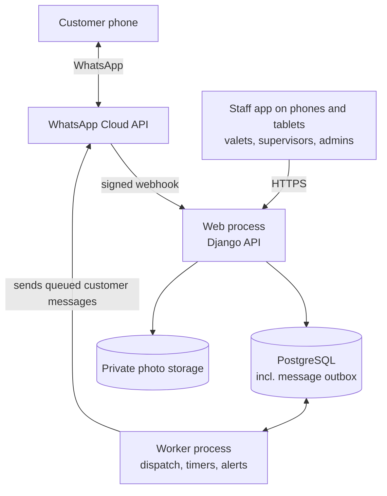
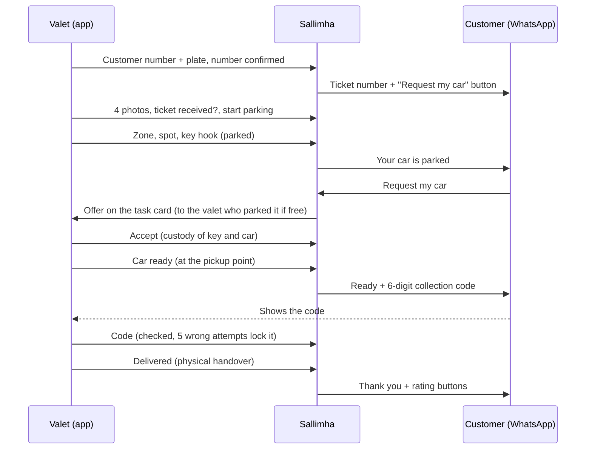
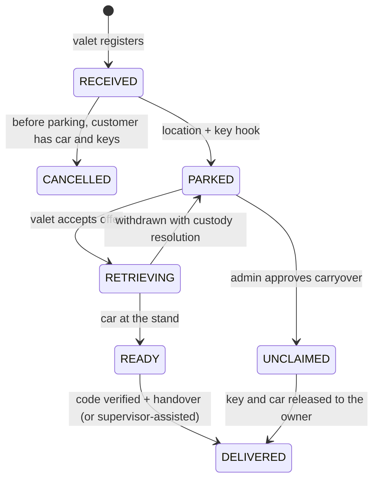

# Sallimha — system overview

How the built system fits together: who uses what, every screen, the main flows and the backend behind them.
Reflects branch `build/phase-0-2` after ADR-0011 (staff web app, customer-only WhatsApp, three roles; November 2026).
Detailed rules live in docs/01–07 and the ADRs referenced below; where they still describe valets working in
WhatsApp or five roles, ADR-0011 takes precedence.

## 1. Who uses what
| Person | Uses | Never uses |
|---|---|---|
| **Customer** | WhatsApp only: receives a ticket, taps "Request my car", gets status updates and a 6-digit collection code, rates the service, can write for help | An app, an account, a QR code |
| **Valet** | The staff app on a phone: My work (current task) and Register car | WhatsApp for work; any supervisor or admin screen |
| **Supervisor** | The staff app on a phone or tablet: Operations and Team | Routine dispatch (the system chooses who retrieves a car); admin screens |
| **Admin** | Everything a supervisor has, plus Dashboard and Settings; second factor required | — |

Locally, a **simulator** stands in for the customer's phone (all results labelled SIMULATED). Nothing is sent to
staff on WhatsApp: no staff message is queued and no staff button token is issued (`STAFF_CHANNEL=app`).

## 2. Screens
Navigation is by role; the server re-checks every permission, so an out-of-role page shows "not permitted".

### Valet (phone; bottom tab bar)
| Screen | What it does |
|---|---|
| **My work** `/work` | The one current task as a card driven by the server's next step: an offer with a countdown (accept / decline), bring the car, car ready, enter the collection code, delivered; a move offer and the new location; custody acknowledgement. Availability (available / break), the operation's name, recent work. Connection indicator; a banner if the connection is lost or customer messages are delayed |
| **Register car** `/register` | Valet | Three stages (ADR-0013): 1 customer number (country selector, Saudi Arabia default; server-validated) and the car (Saudi plate as entered, other plate as written, or no readable plate with a reason; make and colour) — the number as it will be read sits beside **Send ticket**, and a still-active duplicate plate is flagged first; 2 four camera photos, the ticket message's real status, then **Start parking**; 3 zone, floor, spot, a short description, an optional confirmed pin (browser location with accuracy, or placed on the map when configured) and the key hook, then **Parked**. No receipt question |

### Supervisor and admin
| Screen (route) | Who | What it is for |
|---|---|---|
| **Sign in** `/login` | Everyone | Mobile number (or username) and password; admins also a 6-digit code. **First time / forgot password**: the one-time setup code from an admin becomes the person's own password |
| **Operations** `/operations` → `/events/:id` | Supervisor, admin | Opens the active operation. Search at the top; problems first (alerts, customer help, failed customer messages); one queue of active requests ordered by the longest wait — elapsed time with *late* in words, ticket and plate, stage, valet, place and hook — with waiting / on the way / ready filters; team availability in the header; counts in one line; the opening check only when something needs attention. Tablet: the car opens beside the list; phone: stacked |
| **Ticket detail** `/events/:id/tickets/:tid` | Supervisor, admin | Beside the lists on tablets, full screen on phones. Facts, status, holds, incidents, the customer's stored messages, **Contact customer**, **one primary action** and the rest under **More actions** |
| **Incidents** `/events/:id/incidents` | Supervisor (resolve: admin) | Incident list and detail with notes |
| **Carryover** `/carryover` | Admin | Cars and keys kept past their operation; approve and release |
| **Outages** `/outages` | Supervisor reports; admin declares/ends; admin records past outages | Customer WhatsApp outage status, whole-system outage windows and reconciliation |
| **Team** `/team` | Supervisor, admin | Tonight's shifts (start/end, available/busy/break, tasks done), **device not working** and **register a car for that valet**. Admins also: add people, one-time setup codes for valets and supervisors, team membership, roles, deactivate/reactivate; an admin's row shows the last controlled admin access (set up on the server, never in the app — ADR-0012) |
| **Dashboard** `/dashboard` | Admin | The selected operation and its period; one band of four counts (parked, waiting with the oldest wait, delivered, request-to-ready median with its definition); activity by hour from recorded times (empty state until two hours exist); unresolved problems; team availability and workload; **Add staff**; link to the full report and exports |
| **Settings** `/settings…` | Admin | Operation and venue; timings and wording; retention. **Advanced**: message delivery (dead letters, replay), WhatsApp status, simulator (development builds only) |

### Ticket actions (shown only when valid; primary first)
| Situation | Actions |
|---|---|
| Car being received | Cancel (before parking; customer has car and keys), intake exception (photos/vehicle), intake transfer |
| Contact problems | Correct the customer's number (revokes the old link and code); resend the ticket after a failed or unknown message (ADR-0013); confirm receipt only after a correction; Contact customer |
| Parked, no request | Assisted request, relocate (offer to a valet), propose unclaimed |
| Retrieval in progress | Withdraw; after acceptance: withdraw with custody resolution, custody transfer |
| Ready at the stand | Assisted handover (customer without phone or code) |
| Any active ticket | Safety hold / clear hold, open incident |
| Move in progress | Record the new location (after the valet accepted), cancel move |
| Carryover | Approve unclaimed, release key and car (admin) |
| Valet's device not working | Record for that valet: acceptance, car ready, custody received, intake photo, parked |
| After a recorded system outage | Reconcile a handover (admin, second-person verifier) |

## 3. The main flow

Rules that hold throughout: one open request per ticket; one live task per valet (offers count); an accepted task
is never reassigned without a custody record; a queued message is not a delivered one; nothing is shown as done
before the server confirms; every console action that needs accountability asks for a reason and is audited.

**Offers in the app.** An offer reserves the valet from the moment the dispatcher makes it. Its 30-second response
window starts when the valet's app acknowledges that the card is on screen (an explicit, idempotent command;
reading My work changes nothing — ADR-0012); the 60-second hard limit from reservation still applies, so an
offer to a closed or locked phone is released and goes to the next fair valet ("offer not yet shown" appears in
Problems after 15 seconds). The app polls every 3 seconds while in front and refreshes on return and reconnection;
an optional alert sound is never the only way an offer is seen.

### Ticket states

Retrieval requests: WAITING_FOR_PARKING → QUEUED → OFFERED → ACCEPTED → COMPLETED (or WITHDRAWN).
Tasks (intake, retrieval, relocation): OFFERED/RESERVED → ACCEPTED → COMPLETED, or RELEASED (expired, declined,
superseded, custody resolved). Customer contact (no routine receipt question since ADR-0013; the ticket message shows its provider status): UNCONFIRMED → CONFIRMED_IN_PERSON, CORRECTION_REQUIRED or
ASSISTED_FALLBACK. Message delivery (customer messages only) is tracked separately in the outbox.

## 4. Exceptions and recovery
- **Incidents and safety holds:** an incident is a record, separate from the car's state; only a safety hold can
  block retrieval or handover, and it is never bypassed.
- **Relocation (ADR-0007):** a move is an offer to a named valet, shown in their app; the car's location changes only
  when that valet records the new place (or a supervisor does after the valet accepted).
- **Unclaimed cars:** supervisor proposes, admin approves; the key stays on its hook until an admin releases it.
- **Customer help:** a customer's free-text WhatsApp message is stored on the ticket and raises "a customer is asking
  for help" for that operation's team. **Contact customer** opens the number (audited) for a call or WhatsApp from the
  supervisor's own phone; that conversation is outside Sallimha.
- **Staff device not working:** a supervisor marks the valet (with a reason) and records what the valet reports in
  person or by radio; the system still chooses the valet. Cleared when the device works again.
- **Customer WhatsApp outage (ADR-0010, ADR-0011):** staff keep working in the app; Operations and the valets' screens
  say customer messages are delayed; supervisors use assisted request and assisted handover. Supervisors report,
  admins declare and end. On recovery only messages that are still true are delivered.
- **Whole-system outage:** staff keep an offline log → an admin records the window → each handover/intake is
  reconciled with its actual time, the responsible valet, a second-person verifier and evidence.

## 5. Backend structure (services/api)
| App | Responsibility | Key modules |
|---|---|---|
| `core` | Cross-cutting | `audit` (append-only, DB trigger), `crypto` (Fernet field encryption, keyed hashes, key rotation), `idempotency`, `locks`, `worker`, `middleware` (503 on DB outage), `context.staff_channel`, health, `deploy_check`, `rotate_keys` |
| `ops` | The operation | Models incl. account setup codes and customer messages. Services: `intake` (incl. `register_with_guest`, `park`), `dispatch` (incl. `offer_seen` for the app's acknowledgement, `accept_offer`, `decline_offer`), `handover` (incl. `mark_ready_by`, `deliver`), `custody`, `retrieval`, `relocation` (incl. `accept_move`), `holds`, `incidents`, `carryover`, `outage`, `shifts` (incl. `set_assisted`), `staffdir` (setup codes, assignments, `grant_admin_access`), `contact`, `reports` (incl. `dashboard`), `config`, `retention`, `opening`, `media`, `tokens`, `localtime` |
| `messaging` | Customer WhatsApp | Signed `webhook` → `inbound` inbox → `flows.guest` (request, rating, help) → `outbox` (retries, dead letters, relevance check) → `transport` (Cloud API or the simulator). The valet conversation (`flows.valet*`) is retired behind `STAFF_CHANNEL=whatsapp` |
| `console` | Staff app API | `views_valet` + `valet` (the valet's work read model), console views for every screen above, serializers that define the API contract (`contracts/openapi.yaml`), permissions (`IsValet`, `IsConsoleStaff`), second factor, sign-in and setup throttling |

Worker loop (one process, PostgreSQL-backed): inbox → expire offers → expire move offers → dispatch → alerts → send
outbox, plus a heartbeat Operations shows.

## 6. Data and security essentials
- PostgreSQL is the source of truth; constraints enforce one open request per ticket, one live task per valet,
  one open shift per person, one key per hook, one live setup code per person, append-only audit.
- Three roles: VALET, SUPERVISOR, ADMIN. MANAGER and SUPER_ADMIN were migrated to ADMIN with an audit record each.
  The framework superuser flag is not used by the product.
- Customer phones and second-factor secrets are encrypted; lookups use keyed hashes. Valets see masked numbers only;
  supervisors and admins open a full number on request (audited); the number export is admin-only.
- Nobody is given a password: one-time setup codes are stored as keyed hashes, expire after 72 hours, allow five
  attempts and are revoked by a new code or deactivation. Completing setup signs out every other session.
- Photos live in private storage (local disk in the demo, a private S3-compatible bucket on staging) and are
  streamed only through an authorised view.
- Sessions, CSRF, idempotency keys on every command, second factor for admins, sign-in throttling, scope checks on
  every object (valets reach only their own live task and its ticket).

## 7. Running it
| Where | How |
|---|---|
| Local demo | `make demo-clean` (empty operation) or `make demo` (mid-event); app at http://127.0.0.1:5180; accounts in README |
| Tests | `make test` (backend, both channels); `make e2e` (Playwright: valet app, supervisor, admin; phone/tablet screenshots) |
| Deployable image | `Dockerfile`: web (gunicorn), worker (`run_worker`), release job (`migrate` + `deploy_check`) |
| Staging (proposed, not provisioned) | docs/staging/hosting-options.md, infra/staging/, docs/staging/whatsapp-onboarding.md |
