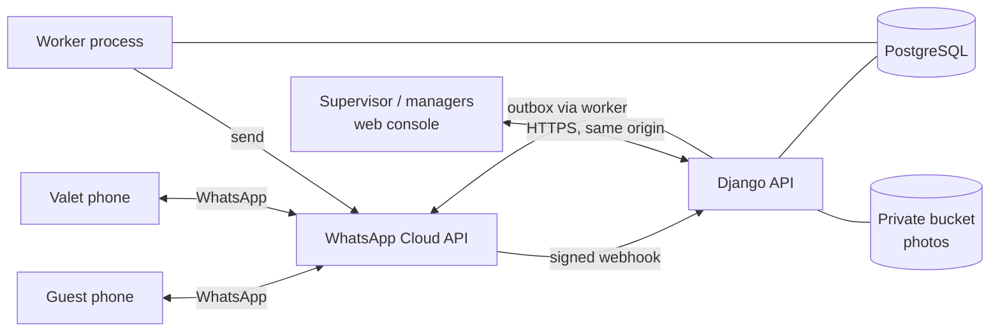
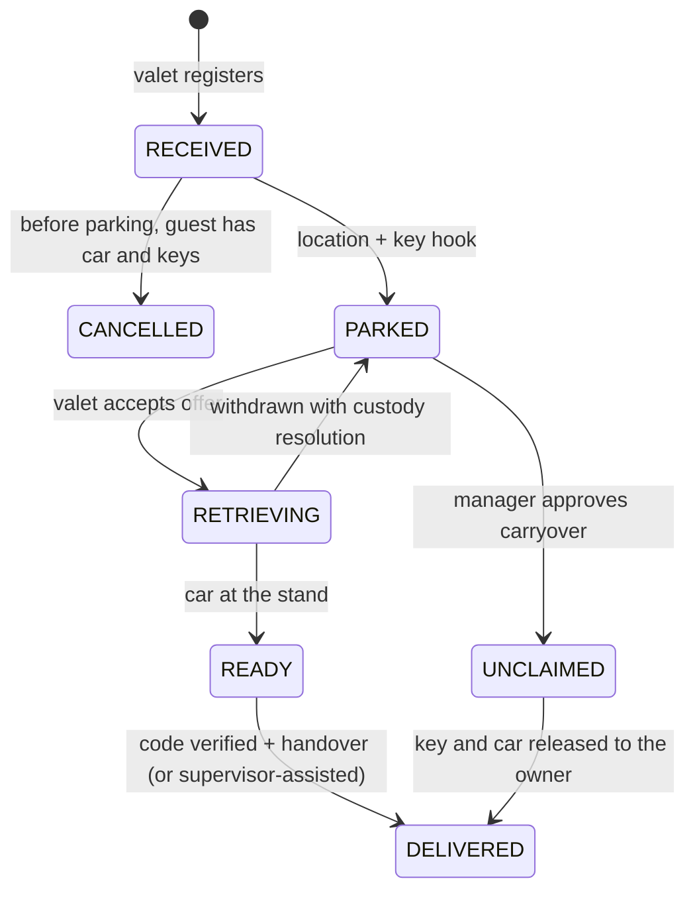

# Sallimha — system overview

How the built system fits together: who uses what, every console page, the main flows and the backend behind them.
Reflects branch `build/phase-0-2` (November 2026). Detailed rules live in docs/01–07 and the ADRs referenced below.

## 1. Who uses what
| Person | Uses | Never uses |
|---|---|---|
| **Guest** | WhatsApp only: receives a ticket, taps "Request my car", shows a 6-digit collection code, rates the service | An app, an account, a QR code |
| **Valet** | WhatsApp only: registers cars, sends photos, records location and key hook, accepts retrieval and move offers, marks "car ready", checks the code, confirms delivery | The console |
| **Supervisor** | Web console: watches live work, starts/ends shifts, handles exceptions, reports outages | Routine dispatch (the system chooses who retrieves a car) |
| **Manager / Admin / Super admin** | Web console: everything a supervisor sees, plus events, staff, reports, settings, operations, integrations (by role) | — |


Locally, a **simulator** replaces WhatsApp (all results labelled SIMULATED).

## 2. Console pages (web, Arabic RTL / English LTR, 360 px to desktop)
Links are shown by role; the server re-checks every permission, so a page above your role shows "not permitted".

| Page (route) | Who | What it is for |
|---|---|---|
| **Sign in** `/login` | All console staff | Username + password; managers and above also enter a 6-digit second-factor code |
| **Events** `/events` | All | Choose an event (opens its live view automatically when only one is open) |
| **Live operations** `/events/:id` | Supervisor+ | Attention list (alerts) first, counters by state, ticket finder (number or plate), open requests with wait time and assignee, team with shifts (start/end, add a new valet to tonight's team), opening check, outage banner |
| **Ticket panel** `/events/:id/tickets/:tid` | Supervisor+ | Facts (vehicle, masked phone, location, key hook, who registered/parked), status pills, holds, incidents, timeline, and only the exception actions the ticket's state and your role allow |
| **Incidents** `/events/:id/incidents` | Supervisor+ (resolve: manager+) | Incident list and detail with notes; managers resolve with an outcome |
| **Outages** `/outages` | Supervisor reports; manager+ declares/ends; manager+ records past outages | WhatsApp outage status, relayed intake, recorded whole-system outages and reconciliation |
| **Events (management)** `/manage` | Manager+ | Create an event (venue time zone), close an event, open its report |
| **Report** `/events/:id/report` | Manager+ (phone export: admin+) | Outcomes, stage times (median/95th), working hours, ratings, CSV exports |
| **Staff** `/staff` | Manager+ (role limits apply) | Directory, add staff, change role (confirmed), deactivate/reactivate, issue two-factor setup (admin+) |
| **Carryover** `/carryover` | Manager+ | Cars and keys kept past their event; open to approve or release |
| **Settings** `/settings` | Admin+ | Dispatch/alert timings, data retention (+ apply), message wording (versioned, conflict-safe) |
| **Operations** `/operations` | Admin+ | Messages needing attention: dead letters and unknown-outcome sends, with replay |
| **Integrations** `/integrations` | Super admin | WhatsApp readiness flags only (never credentials) |
| **Simulator** `/dev/simulator` | Local/test builds only | Act as any valet or guest phone; simulate a WhatsApp provider outage |

### Ticket panel actions (shown only when valid)
| Situation | Actions |
|---|---|
| Car being received | Cancel (only before parking, guest has car and keys), intake exception (photos/vehicle), intake transfer, confirm guest received the ticket |
| Contact problems | Correct guest number (revokes old link and code) |
| Parked, no request | Supervisor-assisted request, relocate (offer to a valet), propose unclaimed |
| Retrieval in progress | Withdraw request; after acceptance: withdraw with custody resolution, custody transfer |
| Ready at the stand | Supervisor-assisted handover (guest without phone/code) |
| Any active ticket | Safety hold / clear hold, open incident |
| Move in progress | Record new location (after the valet accepted), cancel move |
| Carryover | Approve unclaimed, release key and car (manager+) |
| Declared WhatsApp outage | Relayed: valet's acceptance, car ready, custody received, intake photo, parking confirmation |
| After a recorded system outage | Reconcile a handover (manager+, second-person verifier) |

## 3. The main flow: registration to verified delivery
```mermaid
sequenceDiagram
  participant V as Valet (WhatsApp)
  participant S as Sallimha
  participant G as Guest (WhatsApp)
  V->>S: "New car" + guest number
  S->>V: Confirm number?
  V->>S: Confirm
  S->>G: Ticket #001 + "Request my car"
  V->>S: Guest received it (in person)
  V->>S: Plate/description, 4 photos, start parking, location, key hook
  S->>G: Your car is parked
  G->>S: Request my car
  S->>V: Offer to the original valet if free, else the fairest free valet
  V->>S: Accept (custody of key and car)
  V->>S: Car ready (at the stand)
  S->>G: Ready + 6-digit collection code
  G-->>V: Shows the code
  V->>S: Code (checked; 5 wrong attempts lock it)
  V->>S: Delivered (physical handover)
  S->>G: Thank you + rating buttons
```
Rules that hold throughout: one open request per ticket; one live task per valet (offers count); an accepted task
is never reassigned without a custody record; a queued message is not a delivered one; every console action
needs a reason where it matters and is audited.

### Ticket states

Retrieval requests: WAITING_FOR_PARKING → QUEUED → OFFERED → ACCEPTED → COMPLETED (or WITHDRAWN).
Tasks (intake, retrieval, relocation): OFFERED/RESERVED → ACCEPTED → COMPLETED, or RELEASED (expired, declined,
superseded, custody resolved). Guest contact: UNCONFIRMED → CONFIRMED_IN_PERSON, CORRECTION_REQUIRED or
ASSISTED_FALLBACK.

## 4. Exceptions and recovery
- **Incidents and safety holds:** an incident is a record, separate from the car's state; only a safety hold can
  block retrieval or handover, and it is never bypassed.
- **Relocation (ADR-0007):** a move is an offer to a valet; it becomes theirs when they accept; the car's location
  changes only when the move is completed.
- **Unclaimed cars:** supervisor proposes, manager approves; the key stays on its hook across events until a manager
  releases it.
- **WhatsApp outage (ADR-0008, ADR-0010):** health shows "failing" when sends keep failing → supervisor reports →
  manager declares → supervisors relay what valets report (the system still chooses the valet); new arrivals are
  registered, photographed or excepted, then confirmed parked → manager ends the outage → queued messages are
  delivered, anything no longer true is never sent.
- **Whole-system outage:** staff keep an offline log on their phones → manager records the outage window → each
  handover/intake is reconciled with its actual time, the responsible valet, a second-person verifier and evidence.

## 5. Backend structure (services/api)
| App | Responsibility | Key modules |
|---|---|---|
| `core` | Cross-cutting | `audit` (append-only, DB trigger), `crypto` (Fernet field encryption, keyed hashes, key rotation), `idempotency`, `locks`, `worker` (step loop, heartbeat), `middleware` (503 on DB outage), health endpoints, console route serving, `deploy_check`, `rotate_keys` |
| `ops` | The operation | Models: organisation/venue/zones/key board, event, staff/shifts, ticket, guest binding, codes, tokens, media, tasks, requests, custody transfers, alerts, incidents, holds, carryover, outage windows, reconciliations. Services: `intake`, `dispatch`, `handover`, `custody`, `retrieval`, `relocation`, `holds`, `incidents`, `carryover`, `outage`, `shifts`, `staffdir`, `config`, `retention`, `reports`, `opening`, `media`, `tokens`, `localtime` |
| `messaging` | WhatsApp | Signed `webhook` → `inbound` inbox → `flows` (valet, valet retrieval, guest) → `outbox` (retries, dead letters, relevance check) → `transport` (Cloud API or the simulator); `catalogue` (Arabic/English wording) |
| `console` | Web API | Views for every page above, serializers that define the API contract (`contracts/openapi.yaml`), permissions, second factor, login throttling |

Worker loop (one process, PostgreSQL-backed): inbox → expire offers → expire move offers → dispatch → alerts → send
outbox, plus a heartbeat the console shows.

## 6. Data and security essentials
- PostgreSQL is the source of truth; constraints enforce one open request per ticket, one live task per valet,
  one open shift per person, one key per hook, append-only audit.
- Guest phones and second-factor secrets are encrypted; lookups use keyed hashes; phones are masked in the console
  and never exported to managers.
- Photos live in a private bucket and are streamed only through an authorised view.
- Console: session cookies, CSRF, idempotency keys on every command, second factor for managers and above,
  login throttling, scope checks on every object.

## 7. Running it
| Where | How |
|---|---|
| Local demo | `make demo-clean` (empty event) or `make demo` (mid-event); console at http://127.0.0.1:5180; accounts in `seed_demo.py` |
| Tests | `make test` (backend, 437 in CI); `npx playwright test` in `tests/e2e` (39 browser tests, desktop + 360 px) |
| Deployable image | `Dockerfile`: web (gunicorn), worker (`run_worker`), release job (`migrate` + `deploy_check`) |
| Staging (proposed, not provisioned) | docs/staging/hosting-options.md, infra/staging/, docs/staging/whatsapp-onboarding.md |
